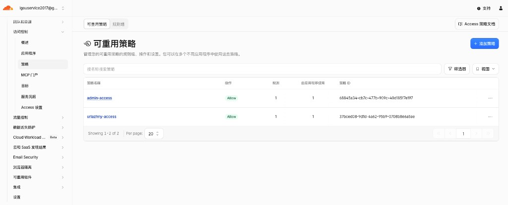
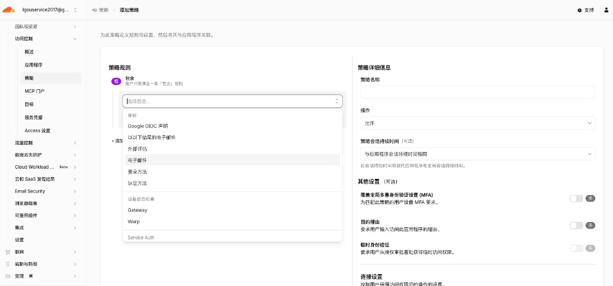
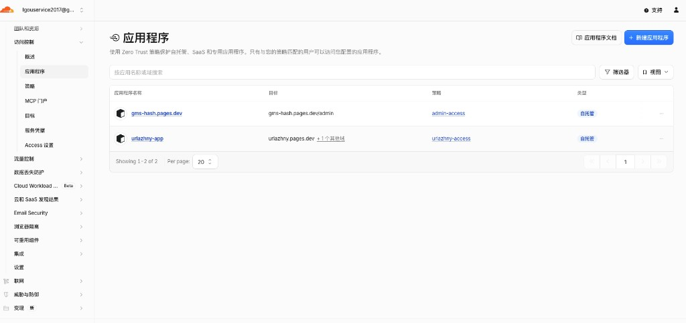
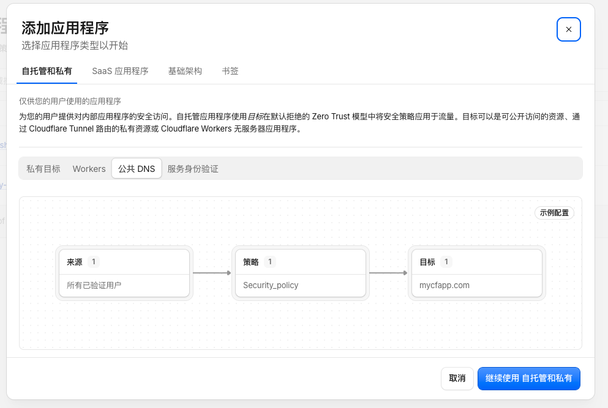
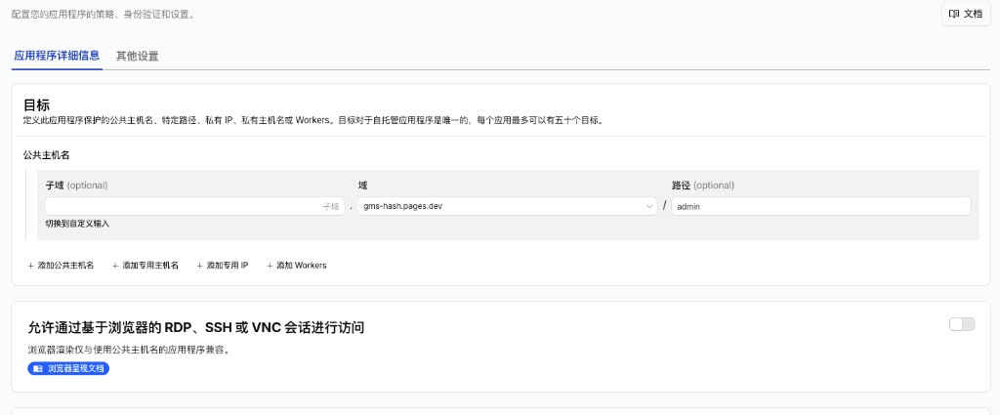
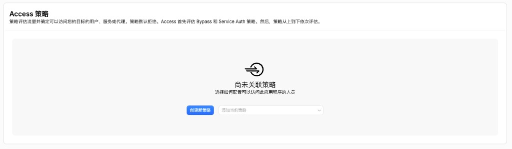
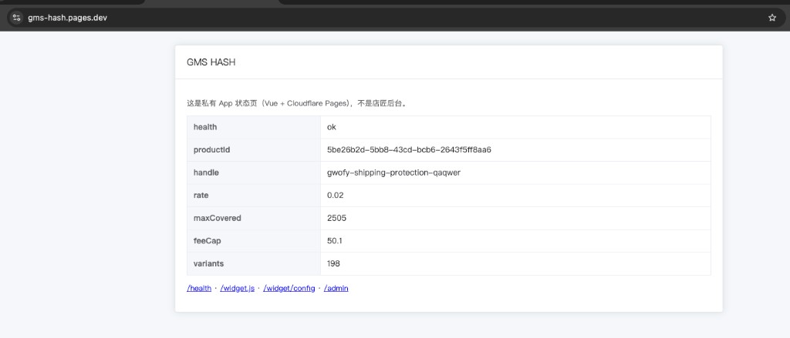
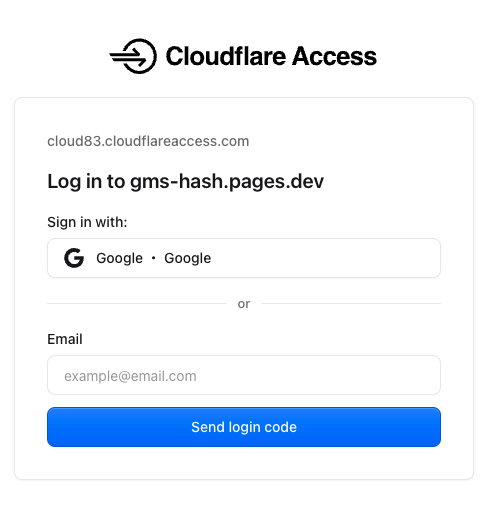
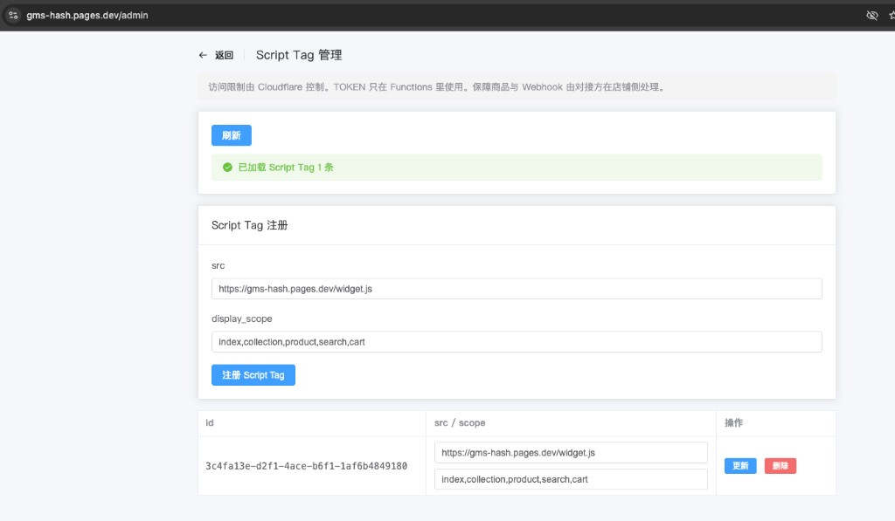

# Cloudflare One 访问控制（Zero Trust Access）

本项目部署在 **Cloudflare Pages** 后，同一域名上同时存在：

| 类型 | 路径 | 谁访问 | 原因 |
|------|------|--------|------|
| **公开** | `/widget.js`、`/widget/config`、`/health` | 全网买家、店匠店面 | Script Tag 与算费配置必须无登录拉取 |
| **公开（建议仍不锁）** | 静态资源（`wf-modal.css` 等） | 店面 | Widget 外链样式 |
| **可选公开** | `/` | 运维 / 任何人 | 状态页（会露出 productId、价档数量，无 Token） |
| **仅工作人员** | `/admin`、`/admin/api/*` | 经 Access 的管理员 | **注册 / 更新 / 注销（删除）** 店匠 Script Tag，背后使用店铺 **TOKEN** |

**`/admin` 没有应用内登录。** 若不配置 **Cloudflare Access**（Zero Trust），任何人均可打开管理页并增删改 Script Tag，等同于把 Private App 的 **`write_script_tags`** 能力暴露到公网。

本地 `npm run dev` **不**经过 Access，仅供本机调试；**线上 Pages 必须配置 Access 后再登记 Script Tag。**

---

## 控制台入口（One 面板）

在 Cloudflare 账号中打开 **Zero Trust**：

- 路径：**`/one/access-controls/apps`**
- 完整地址形态：`https://one.dash.cloudflare.com/<账号 ID>/access-controls/apps`

相关入口：

| 菜单（中文界面） | 用途 |
|------------------|------|
| **访问控制 → 应用程序** | 绑定域名 + Path，挂上策略 |
| **访问控制 → 策略** | 先建 **可重用策略**（谁允许进 `/admin`） |

下文 **策略（Policy）** 指可重用规则；**应用程序（Application）** 指 Self-hosted 域名与路径。

---

## 推荐顺序：先策略，后应用程序

1. **创建可重用策略**（Allow + 邮箱 / 登录方式）  
2. **创建 Self-hosted 应用程序**（仅 `/admin*`），并 **选用** 上一步策略  
3. 无痕验证店面 `widget.js` 仍为公开  

---

## 步骤一：创建可重用策略（Policy）

在 Zero Trust 侧边栏打开 **访问控制 → 策略**（英文：**Access → Policies**），进入 **可重用策略** 列表。



点击 **+ 添加策略**（或 **Add a policy**）。

### 策略详细信息（右侧）

| 字段 | 建议 |
|------|------|
| **策略名称** | 如 `admin-access`（本项目管理 Script Tag 的人员） |
| **操作** | **Allow（允许）** |
| **策略会话持续时间** | 默认「与应用程序会话持续时间相同」即可 |

### 策略规则：Include（包含）

在 **Include** 中定义 **谁可以放行**。点选器内常见项（以控制台为准）：

| Include 类型 | 说明 | 典型用法 |
|--------------|------|----------|
| **电子邮件（Email）** | 白名单具体邮箱 | `ops@company.com`、`you@gmail.com` |
| **以下结尾的电子邮件** | 邮箱域名后缀 | `@yourcompany.com` |
| **登录方法（Login Method）** | 限定通过何种 IdP 登录 | 仅用 Google / GitHub 等（需先在 **设置 → 身份验证** 接入） |
| **认证方法** | 更细的 MFA / 方式要求 | 按公司安全基线 |
| Google OIDC 声明 等 | 与已接 IdP 联动的声明 | 企业 SSO 场景 |



**示例（小团队）：**

1. Include → **电子邮件** → 填入运维同事邮箱（可多条规则或多策略合并，按控制台能力操作）。  
2. 操作 **Allow** → 保存。

保存后，策略会出现在 **可重用策略** 表中（名称如 `admin-access`，**由应用程序使用** 计数 ≥ 1 表示已绑定应用）。

同一策略可被多个 Application 引用（例如 `/admin` 与可选的 `/` 状态页）。

> **默认拒绝**：未命中任何 Allow 的访问者无法进入受保护路径；不要在 Application 上额外添加 **Allow everyone**。

---

## 步骤二：按路径建应用程序，并挂上策略

### 原则：按路径保护，勿锁整域

### 原则

1. **Self-hosted** 应用绑定你的 Pages 域名（`*.pages.dev` 或自定义域）。
2. 用 **Path** 限定到管理面，**不要** 用一条规则盖住整个主机名。
3. 为 `/admin` 与 `/admin/api` 建立保护（可一个应用多路径，或两个应用，见下）。
4. **`/widget.js`、`/widget/config` 永远不要加入 Access 应用的路径。**

### 路径对照（本项目）

| Path | Access | 说明 |
|------|--------|------|
| `/admin` | **必须** | Vue 管理页（Script Tag 列表/注册） |
| `/admin/api` 及子路径 | **必须** | Functions：`GET/POST/PUT/DELETE` Script Tag |
| `/` | **建议** | 首页状态与 `/widget/config` 链接；不锁也能用，但会暴露商品 id 与价档数量 |
| `/widget.js` | **禁止保护** | 店匠 Script Tag `src` |
| `/widget/config` | **禁止保护** | 店面 bootstrap 拉配置 |
| `/health` | **禁止保护** | 可选探活；在 `public/_routes.json` 中走 Functions |

> Pages 上 `public/_routes.json` 将 `/admin/api/*`、`/widget/config`、`/health` 交给 Functions；Access 在 **HTTP 入口** 判断，与 Vue SPA 路由无关。

### 1. 进入应用程序并新建

侧边栏 **访问控制 → 应用程序**，点击 **+ 添加应用程序**。

列表中可看到已创建的应用（域名、域名 + 路径、已关联策略、类型「自托管」），例如：



### 2. 选择类型：自托管和私有

在 **添加应用程序** 向导中：

1. 选 **自托管和私有**（Self-hosted and private）。
2. 子类选 **公共 DNS**（Public DNS）——对应通过 **公网主机名** 保护的 Pages 站点。
3. 点击 **继续使用 自托管和私有**。



### 3. 目标：部署域名 + 路径 `admin`（关键）

在 **应用程序详细信息 → 目标** 中配置 **公共主机名**：

| 字段 | 填写 |
|------|------|
| **子域** | 一般留空（`*.pages.dev` 整段在「域」里选） |
| **域** | 你的 **Pages 部署域名**，如 `gms-hash.pages.dev`（与 `PUBLIC_BASE_URL` 一致） |
| **路径** | **`admin`**（不要留空；不要填整站 `/*`） |

控制台会显示目标形如：`gms-hash.pages.dev/admin`。



**为什么路径必须是 `admin`：**

- 仅保护 **`/admin` 前缀**，`https://<域>/widget.js`、`/widget/config` 仍 **不经 Access**，店面可加载。
- 路径留空 ≈ 锁整站，会导致 Script Tag **302 到 cloudflareaccess.com**。
- 本项目管理页在 **`/admin`**；Functions 在 **`/admin/api/*`**。若管理页 API 被拦，在同一应用下 **再添加一条公共主机名**，路径填 **`admin/api`**（或控制台支持的等价写法），**域相同**。

**浏览器呈现**（RDP/SSH/VNC）保持 **关**——与本项目无关。

### 4. 关联策略

切换到 **Access 策略** 页签。若显示 **尚未关联策略**：

1. 点击 **添加当前策略**（Add existing policy）。
2. 选择步骤一创建的 **`admin-access`**（Allow + 邮箱/登录方式）。
3. **不要** 在此新建「Allow everyone」。



也可点 **创建新策略**，但推荐用可重用策略，便于多应用复用。

### 5. 保存并验证

保存应用程序。列表中应出现：

- **名称**：常用 Pages 项目名或域名  
- **域名 + 路径**：`<你的域>/admin`  
- **策略**：`admin-access`  
- **类型**：自托管  

工作人员访问 `https://<域>/admin` 时应先 **Cloudflare 登录**，通过后进入 Script Tag 管理页。

### （可选）保护首页 `/`

另建一条应用程序，路径仅 **`/`**（或单独 path 规则），同样挂 `admin-access`。  
不保护 `/` 时不影响店面 Widget。

### 关于 `/admin/api`

`public/_routes.json` 将 `/admin/api/*` 交给 Functions。若未登录时 **Script Tag API 返回 302**，请在本应用 **+ 添加公共主机名**：同一域、路径 **`admin/api`**，策略仍为 `admin-access`。

---

## 步骤三：验证（首页公开 + `/admin` 需授权）

配置保存后，用浏览器按下面顺序自测（示例域名：`gms-hash.pages.dev`）。

### 1. 首页可匿名访问

直接打开部署根地址（**未**登录 Cloudflare Access）：

`https://<你的 Pages 域名>/`

应看到本项目 **状态页**（GMS HASH：health、productId、rate、价档数量等），底部链接含 `/health`、`/widget.js`、`/widget/config`、`/admin`。



说明：Access 应用程序路径为 **`admin`** 时，**`/` 不受保护**；这与「店面 Widget 路径保持公开」一致。

### 2. 打开 `/admin` 出现 Access 登录

在同一浏览器 **无痕窗口**（或退出 Access 会话）访问：

`https://<你的 Pages 域名>/admin`

应跳到 **Cloudflare Access** 登录页（标题形如 *Log in to &lt;你的域&gt;*），可选择：

- **Google**（或其它已接入 IdP）
- **Email** → 输入策略允许的邮箱 → **Send login code**（一次性验证码）



未在策略 **Include** 中的账号应 **无法** 通过；通过后才进入本站管理 UI。

### 3. 授权后进入 Script Tag 管理

登录成功后应看到 **Script Tag 管理** 页（`src/pages/AdminPage.vue`）：



页顶说明：**访问限制由 Cloudflare 控制**；**TOKEN** 只存在 Pages Secrets，由 Functions 调店匠 OpenAPI，**不会**出现在浏览器里。

**管理员在本页可做的操作：**

| 操作 | 界面 | 作用 |
|------|------|------|
| **刷新** | 列表上方按钮 | 重新拉取当前店铺已注册的 Script Tag |
| **注册** | 「Script Tag 注册」表单 + **注册 Script Tag** | 在店匠新建一条脚本，`src` 指向你的 `widget.js` |
| **更新** | 表格行内改 `src` / `display_scope` + **更新** | 换域名、改展示页面范围等 |
| **注销** | 行内 **删除**（确认后） | 从店匠 **移除** 该 Script Tag，店面不再注入该脚本 |

注销即 OpenAPI 删除对应 `script_tag`；删除后购物车将不再加载该 `src`，直到重新注册。

**注册示例：**

| 字段 | 值 |
|------|-----|
| **src** | `https://<你的 Pages 域名>/widget.js` |
| **display_scope** | `index,collection,product,search,cart` |

管理员无需登录店匠后台即可维护脚本；但必须已通过 **Access**，且部署环境配置了有效 **`TOKEN`** 与 **`write_script_tags`** scope。

从首页点 **「管理」** 会在 **新窗口** 打开 `/admin`；该窗口同样需完成 Access 登录（若尚无会话）。

### 4. 店面路径（建议无痕再测）

以下 URL **不应** 要求 Cloudflare 登录，均应 **HTTP 200**：

- `https://<域>/widget.js`
- `https://<域>/widget/config`

店匠购物车 Network 中亦不应出现跳转到 `cloudflareaccess.com`。

---

## 错误配置与现象

| 现象 | 常见原因 | 处理 |
|------|----------|------|
| 购物车无 Widget；Network 里 `widget.js` **302** 到 `cloudflareaccess.com` | Access 绑了 **整域** 或未排除 `/widget.js` | 改为仅 `/admin*` path；删除整站应用 |
| 登录 Access 后被 **308/302 到 `/`**，进不了 `/admin` | Access 的 **Redirect URL / Return URL** 或应用 **Path** 配错 | 回调应回到请求的原始 URL（如 `/admin`）；检查应用 domain+path |
| `/admin` 仍任何人可进 | 未建 Application、Policy 为 Allow Everyone、或域名绑错 | 核对域名与 Path、Policy 仅工作人员 |
| 同事无法登录 | 邮箱不在 Allow 列表、IdP 未同步 | 更新 Policy 或 IdP group |
| `CORS` / `widget/config` 失败 | 误保护 `/widget/config` | 从 Access 应用移除该 path |

更细的联调说明见 [troubleshooting.md](./troubleshooting.md#无痕访问-admin-被-308-到-)。

---

## 与项目能力的关系

```text
工作人员 ──(Access 放行)──▶ /admin
                              │
                              └──▶ /admin/api/script-tags*  ──▶ 店匠 OpenAPI（TOKEN）

买家店面 ──(无 Access)──▶ /widget.js
                              └──▶ /widget/config  （无 TOKEN，仅价档+费率）
```

- **TOKEN** 仅存 Cloudflare Pages **Secrets**，不经浏览器下发。
- Access 保护的是 **谁能打开管理 UI 并触发 Functions**；不保护时，攻击者可代你调用同一 API。

管理入口：站点首页 **「管理」** 会以 **新窗口** 打开 `/admin`（见 `src/openAdmin.js`），工作人员需在该窗口完成 Access 登录。

---

## 上线顺序建议

1. Pages 部署成功，环境变量（含 `TOKEN`）已配置。
2. **可重用策略** `admin-access`（邮箱或登录方式）已创建。
3. **应用程序** 仅保护 `/admin`、`/admin/api*` 并挂上该策略。
4. 工作人员登录验证 `/admin` 可用。
5. 再在 `/admin` 注册 Script Tag：`src = {PUBLIC_BASE_URL}/widget.js`。
6. 店匠购物车无痕验证 `widget.js`、`/widget/config` 为 **200**。

---

## 检查清单

对照 [步骤三：验证](#步骤三验证首页公开--admin-需授权) 与截图 `access-07`～`access-09`。

### 公开访问（无 Access 登录）

- [ ] `https://<域名>/` 状态页正常（同 access-07）  
- [ ] `GET /widget.js`、`/widget/config` → **200**  
- [ ] 店匠购物车 Network 无 `cloudflareaccess.com` 跳转  

### 管理面（仅工作人员）

- [ ] 未登录访问 `/admin` → Access 登录页（同 access-08）  
- [ ] 授权后进入 Script Tag 管理（同 access-09）  
- [ ] `/admin/api/*` 为 200，非 302  

### 安全

- [ ] 无「整域」Access 应用  
- [ ] 未授权会话不能操作 Script Tag  

---

## 相关文档

- [部署到 Cloudflare Pages](./deploy-cloudflare.md) — 步骤六摘要  
- [本项目说明](./overview.md)  
- [联调与排障](./troubleshooting.md)  
- [仓库 README — Access](../../README.md#线上必须加-cloudflare-access否则谁都能看都能改)