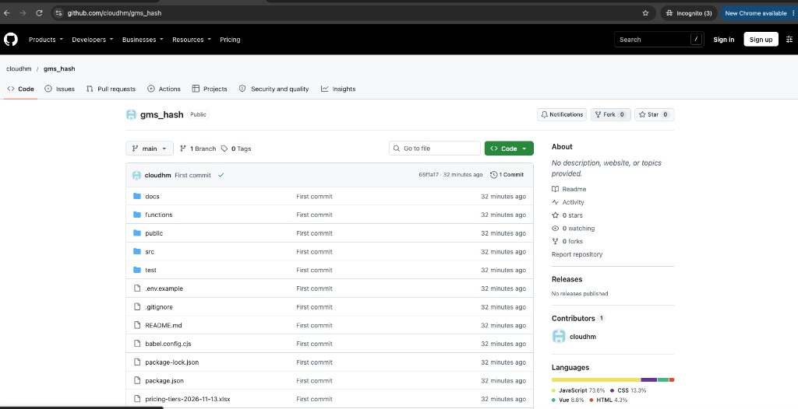
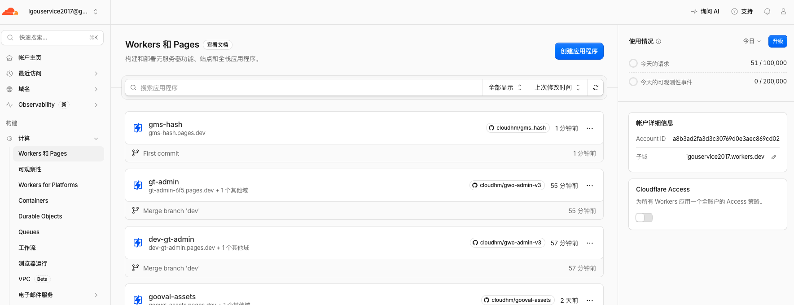
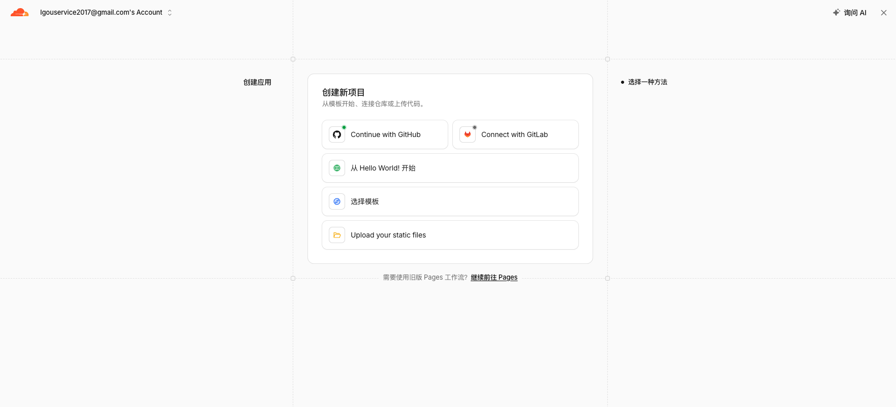
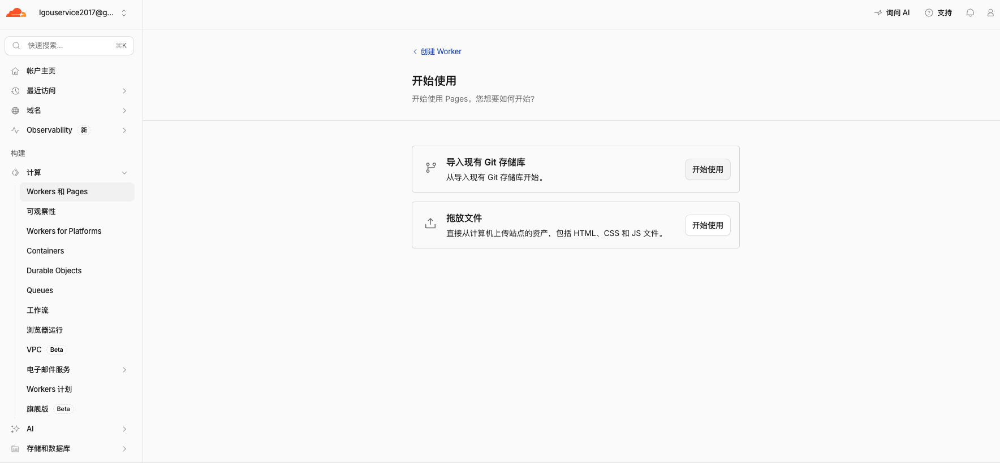
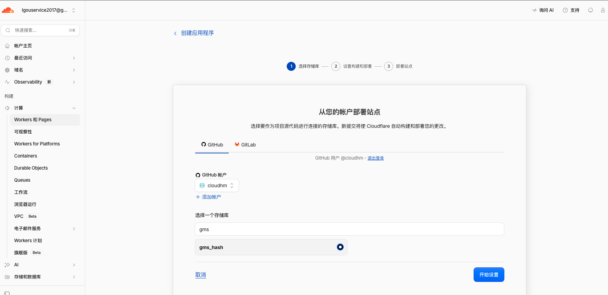

# 部署本项目（GitHub Fork → Cloudflare Pages）

商家运维在 GOOVAL 完成建品与开号后，将 **Shipping Secure Service** 部署到 **自有 Cloudflare 账号**，再在 `/admin` 注册 Script Tag。  
前置条件见 [GOOVAL 接入](./gooval-onboarding.md) 与 [私有应用](./private-app.md)。

---

## 流程概览

```text
GitHub 找到上游仓库 → Fork 到自己的账号
    → Cloudflare Workers & Pages → 连接 GitHub 仓库
    → 配置构建（npm run build / dist / functions）
    → 配置环境变量 → 首次部署
    → Cloudflare Access 保护 /admin
    → /admin 注册 Script Tag
```

---

## 步骤一：在 GitHub 找到项目并 Fork

1. 浏览器打开上游仓库（示例）：

   **https://github.com/cloudhm/gms_hash**

   页面应能看到 `docs/`、`functions/`、`public/`、`src/`、`.env.example` 等目录（Shipping Secure Service 私有 App）。

2. 登录 **你自己的 GitHub 账号**（须与后续 Cloudflare 绑定的 GitHub 一致或有权访问）。

3. 点击仓库右上角 **Fork**，选择 fork 到 **你的用户或组织**，确认创建。

   

4. Fork 完成后，记下你的仓库地址，形如：

   `https://github.com/<你的用户名>/gms_hash`

   后续 Cloudflare 将拉取 **你 fork 后的仓库**，而非直接使用 `cloudhm/gms_hash`。

> 若上游仓库名或组织有变，以 GOOVAL / 交付方提供的链接为准；步骤相同。

---

## 步骤二：进入 Cloudflare Workers & Pages

1. 登录 **[Cloudflare 控制台](https://dash.cloudflare.com/)**（使用 **商家自己的** Cloudflare 账号）。

2. 左侧进入 **计算（Compute）→ Workers 和 Pages**，看到已部署项目列表（首次可为空）。

   

3. 点击右上角 **创建应用程序**（Create application）。

---

## 步骤三：使用旧版 Pages 工作流

点击 **创建应用程序** 后，会出现「创建新项目」卡片（含 GitHub / GitLab 等入口）。  
**请使用旧版 Pages 流程**（与本仓库 Vue CLI + `functions/` 部署方式一致）：

1. 在卡片底部点击：**需要使用旧版 Pages 工作流？→ 继续前往 Pages**

   

2. 在 **Pages** 入口页选择 **从现有 Git 存储库导入** → **开始使用**。

   

3. 首次使用需 **授权 Cloudflare 访问 GitHub**，安装 GitHub App，并勾选 **你 fork 的仓库**。

> 不要在本步骤直接点 **Continue with GitHub**（统一 Worker 创建流）；应通过底部链接进入 **Pages** 再连 Git。

---

## 步骤四：选择仓库并开始设置

1. 在 **GitHub** 标签下选择你的 GitHub 账号/组织。

2. 搜索并选中 fork 后的仓库（示例名 **`gms_hash`**）。

3. 点击 **开始设置**（Begin setup）。

   

4. 点击 **开始设置**，进入 **设置构建和部署**（向导第 2 步）。

---

## 步骤五：构建设置、环境变量与首次部署

### 5.1 构建设置

在 **设置构建和部署** 页按下列填写（仓库根目录为项目根，勿改子目录）：

| 项 | 填写值 |
|----|--------|
| 生产分支 | `main`（或 fork 后的默认分支） |
| **框架预设** | **Vue** |
| **构建命令** | **`npm run build`** |
| **构建输出目录** | **`dist`** |
| 根目录 | `/`（留空或仓库根） |

**Functions：** Cloudflare Pages 会自动识别仓库根目录下的 **`functions/`**，无需单独配置。

### 5.2 环境变量（与本地 `.env` 逐项对应）

在向导中的 **环境变量** 区域，或部署后到 **设置 → 变量和机密**，按本地 [`.env.example`](../../.env.example) **一行一项** 添加（名称与 `.env` 键名完全一致）：

| 变量名 | 类型 | 说明 | 示例 |
|--------|------|------|------|
| `TOKEN` | **Secret** | 与私有 App 一致 | 店匠后台复制 |
| `APP_UID` | Variable | 与私有 App 一致（备份） | 代码不读 |
| `APP_SECRET` | Secret | 与私有 App 一致（备份） | 代码不读；GOOVAL Webhook 用 |
| `WEBHOOK_API_VERSION` | Variable | 与私有 App 一致 | `2026-07` |
| `API_DOMAIN` | Variable | GOOVAL 根 URL；费率来自 `app-config.js` | 测试 `https://sp-test.gooval.io` / 生产 `https://sp-prod.gooval.io` |
| `SHOP_DOMAIN` | Variable | 店匠店铺域名 | `xxx.myshoplaza.com` |
| `PROTECTION_HANDLE` | Variable | GOOVAL 维护的保障商品 handle | `gwofy-shipping-protection-qaqwer` |
| `PUBLIC_BASE_URL` | Variable | 部署后可访问根 URL（无尾斜杠） | `https://<项目>.pages.dev` |

字段含义与校验命令见 **[environment-variables.md](./environment-variables.md)**。接 GOOVAL 时 **不必** 配 `PROTECTION_RATE` / `PROTECTION_MAX_COVERED`。勿配 `PROTECTION_PRODUCT_ID`、`FUNCTIONS_PROXY`。

> 本地对照：复制 `cp .env.example .env` 填好后，把同一套键值照抄到 Cloudflare（`TOKEN` 务必用 Secret）。

### 5.3 保存并部署

1. 确认构建设置与变量后，继续向导并完成 **首次部署**。
2. 记下生产地址，例如 `https://<项目名>.pages.dev`。
3. 若 `PUBLIC_BASE_URL` 与最终域名不一致，在变量里改正后 **重新部署** 一次。

---

## 步骤六：Cloudflare One 访问控制（Zero Trust Access）

本项目 **一部分路径必须公网可访问**（店面 `widget.js`），**`/admin` 仅允许相关工作人员** 管理 Script Tag（无应用内口令，靠 Access 拦截）。

| 路径 | Access |
|------|--------|
| `/admin`、`/admin/api*` | **必须保护** |
| `/widget.js`、`/widget/config` | **不要保护** |

**操作说明（路径、Policy、常见误配、检查清单）** 见专文 **[cloudflare-access.md](./cloudflare-access.md)**。  
摘要亦见 [README — Cloudflare Access](../../README.md#线上必须加-cloudflare-access否则谁都能看都能改)。

配置顺序：**访问控制 → 策略**（可重用 Allow，邮箱或登录方式）→ **应用程序**（Self-hosted，Path `/admin*`）。  
控制台：`/one/access-controls/policies`、`/one/access-controls/apps`。截图见 [cloudflare-access.md](./cloudflare-access.md)。

---

## 步骤七：注册 Script Tag（管理员在 `/admin`）

1. 完成 [cloudflare-access.md](./cloudflare-access.md) 中的 Access 配置后，打开 **`https://<你的域名>/admin`** 并完成授权。

2. 在 **Script Tag 管理** 页 **注册**（换域名时用 **更新**，下线 Widget 时用 **删除** 注销脚本）：

   - **src**：`{PUBLIC_BASE_URL}/widget.js`
   - **display_scope**：`index,collection,product,search,cart`

3. 到店匠 **购物车页、购物车抽屉、说明弹窗** 验 Widget（截图与说明见 [storefront.md § Script Tag 注册后](./storefront.md#script-tag-注册后店面验收)）。

也可从首页点击 **管理**（新窗口打开 `/admin`）。非管理员无法进入该页。

也可在本地配置 `.env` 后执行 `npm run register-script`（`PUBLIC_BASE_URL` 须为公网 HTTPS）。

---

## 检查清单

- [ ] 已从 GitHub **Fork** 仓库到自己的账号  
- [ ] Cloudflare Pages 已连接该 fork 并成功 `npm run build`  
- [ ] 已配置 `API_DOMAIN`（GOOVAL 交付）；生产环境勿再依赖 `PROTECTION_RATE` 兜底  
- [ ] 环境变量与 `PUBLIC_BASE_URL` 正确  
- [ ] Access 仅保护 `/admin*`  
- [ ] Script Tag 指向线上 `widget.js`  
- [ ] 购物车可加载 `widget.js`、`/widget/config`（无痕 200，非 Access 302）  
- [ ] Cart / Cart Drawer / Dialog 均显示 Shipping Secure Service（见 [storefront.md](./storefront.md)）  

---

## 相关文档

- [本项目说明](./overview.md)
- [GOOVAL 店匠开号流程](./gooval-onboarding.md)
- [联调与排障](./troubleshooting.md)
- [仓库 README — 本地开发与部署](../../README.md)