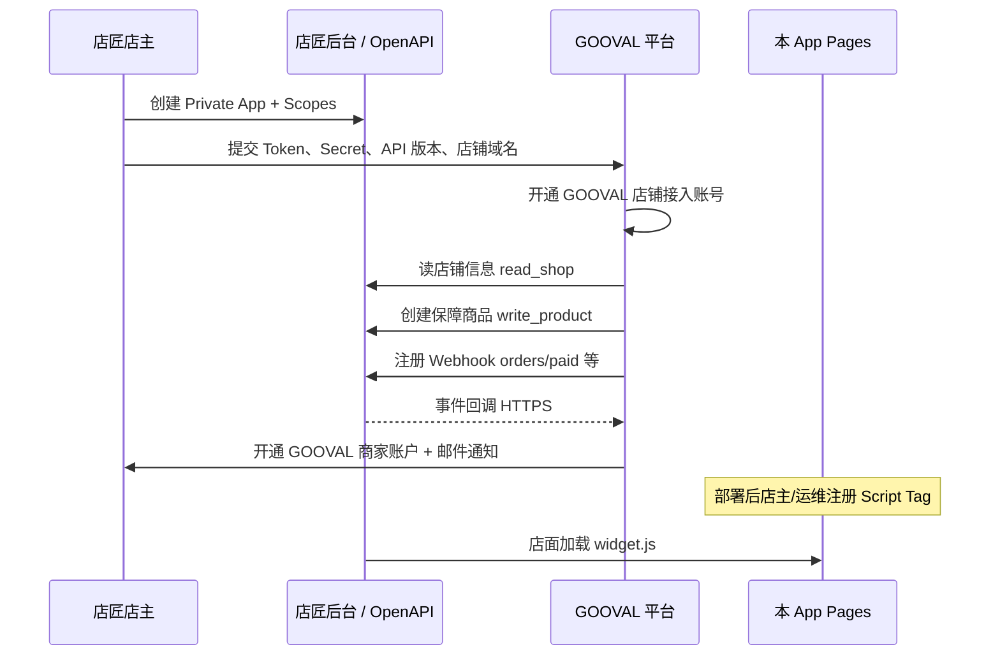

# GOOVAL 接入店匠店铺（商家侧与平台侧）

本文描述 **店匠店铺店主** 与 **GOOVAL** 在开通 Shipping Secure Service 时的分工：店主提供私有应用凭证，GOOVAL 完成账户开通、读店、建保障商品，并为店主开通 GOOVAL 商家账户与邮件通知。

与本文配套：

- **测试联调路径**（Partner 测试店 + 联系 GOOVAL 测试开号）：[test-environment.md](./test-environment.md)
- 店主如何创建私有应用：[private-app.md](./private-app.md)
- 本仓库部署 Widget / Script Tag：仓库根目录 [README.md](../../README.md)

---

## 角色与目标

| 角色 | 职责 |
|------|------|
| **店匠店铺 Owner** | 在店匠后台创建 **Private App**，按约定配置 Scopes，将凭证提供给 GOOVAL；保管 App Secret，不公开给无关第三方 |
| **GOOVAL** | 用凭证 **开通店铺接入账号**；**读店铺信息**、**创建保障商品**；在店匠 **注册 Webhook**（如订单支付等 topic）；为店主 **开通 GOOVAL 商家账号** 并 **邮件通知** |
| **本仓库（Shipping Secure Service App）** | 托管 `widget.js` 与 `/widget/config`；在店匠注册 Script Tag；**不**代 GOOVAL 建品（建品由 GOOVAL OpenAPI 完成） |



---

## 一、店主提供给 GOOVAL 的信息

店主按 [private-app.md](./private-app.md) 创建私有应用后，向 GOOVAL 提供以下字段（建议通过 **GOOVAL 指定安全渠道**，勿在公开 IM 明文长期留存 Secret）：

| 字段 | 说明 | 示例 / 格式 |
|------|------|-------------|
| **Token** | 私有应用 **Access Token**（OpenAPI `Access-Token`） | 后台「应用详情」复制 |
| **App Secret** | 应用密钥 | 仅 GOOVAL 侧安全存储；**本仓库 `.env` 不配置** |
| **WEBHOOK_API_VERSION** | WebHook / OpenAPI 版本 | 固定 **`2026-07`**（与店主后台一致） |
| **店铺域名** | 店铺主域名 | `xxx.myshoplaza.com`（**不要**带 `https://`） |

可选一并提供（本地备份，GOOVAL 按内部规范处理）：

| 字段 | 说明 |
|------|------|
| **App UID** | 应用 UID |

### 私有应用 Scopes（店主创建时应已勾选）

与 [README Scopes](../../README.md#scopes权限) 一致，至少包含：

```text
read_product,write_product,read_order,read_script_tags,write_script_tags,read_shop,read_cart_transform,write_cart_transform
```

| 后台权限 | 选择 |
|----------|------|
| 商品权限 | 读取和写入 |
| 订单权限 | 读取 |
| 自定义代码权限 | 读取和写入 |
| 店铺信息权限 | 读取 |
| 购物车转换 | 读取和写入 |

**说明：** GOOVAL 建品、读店依赖 `write_product`、`read_shop` 等；店面 **Script Tag** 注册可由店主或运维在本 App 的 `/admin` 完成（需同一 Token 具备 `write_script_tags`）。若 GOOVAL 代为注册脚本，需约定是否共用同一 Private App Token。

---

## 二、GOOVAL 开通流程（平台侧）

GOOVAL 收到上节凭证后，按内部 SOP 执行（以下为对接约定说明，具体系统界面以 GOOVAL 产品为准）。

### 1. 开通 GOOVAL 店铺接入账号

- 在 GOOVAL 后台创建与该 **店匠店铺域名** 绑定的接入记录。
- 写入：`SHOP_DOMAIN`、`TOKEN`、`WEBHOOK_API_VERSION`；**App Secret** 存入 GOOVAL 密钥库（用于 Webhook 签名校验等，若适用）。
- 在 GOOVAL 侧配置店铺 **`app-config.js`**（接口根地址：`https://sp-test.gooval.io` / `https://sp-prod.gooval.io`）。**店匠本 App 只消费** `GWOFY_CONFIG.pricing` 的 **`calcRate`**、**`spMaxCoverage`**；响应中其余字段与 Shopify 插件共用，见 [gooval-app-config.md](./gooval-app-config.md)。商家配置 **`API_DOMAIN`** 指向对应环境即可，**无需**在 Pages 重复维护费率。

### 2. 读取店铺信息

使用 OpenAPI（示例路径形态，以店匠文档为准）：

- Header：`Access-Token: {Token}`
- Base：`https://{店铺域名}/openapi/{WEBHOOK_API_VERSION}/…`
- Scope：**`read_shop`**
- 用途：校验店铺可访问、拉取店名/币种/域名等，用于 GOOVAL 商家后台展示与对账。

### 3. 在店匠创建保障商品

- Scope：**`read_product`**、**`write_product`**
- GOOVAL 调用商品创建/更新接口，在该店注入保障商品，**handle、variants（价档 SKU）、图片、可售状态** 符合 GOOVAL 与接入约定（默认可对齐 `PROTECTION_HANDLE`，如 `gwofy-shipping-protection-qaqwer`）。
- 创建完成后，本 App 的 `GET /widget/config` 将按 **同一 handle** 拉取 `productId` 与 `variants`，并按 **`API_DOMAIN`** 拉取 **`calcRate` / `spMaxCoverage`**（见 `src/catalog.js`、`src/goovalAppConfig.js`）。

### 4. 注册店匠 Webhook（与开号同步）

GOOVAL 在 **注册店铺 / 开通接入账号** 时，用同一 Private App **Token** 调用店匠 OpenAPI **创建 Webhook 订阅**（具体路径以 `WEBHOOK_API_VERSION` 文档为准，形态类似 `POST …/webhooks`）。

每条订阅绑定：

| 字段 | 说明 |
|------|------|
| **topic** | 事件主题，如 **`orders/paid`**（订单已支付）、以及业务需要的其它 topic（如 `orders/create`、`orders/fulfilled` 等） |
| **address** | GOOVAL **公网 HTTPS** 回调地址（按店铺维度或统一入口 + 店铺标识路由） |

约定要点：

- **Topic 字面量** 以 [店匠开放平台 Webhook 文档](https://www.shoplazza.com/) 为准，勿臆造；对接清单中应列出 GOOVAL 实际订阅的全部 topic。
- **`orders/paid`（或平台等价事件）** 用于支付后理赔、对账、保障生效等后续流程（GOOVAL 业务实现）。
- **App Secret** 用于校验回调签名（若店匠按 Secret 签名）；Secret 仅存 GOOVAL 侧，与本 Shipping Secure App 无关。
- 同一店铺 **重复开号** 时应先 `list` 已有 Webhook，避免重复订阅；换回调域名时 `update` / 删旧建新。
- **本仓库不提供** Webhook 接收路由；所有事件由 **GOOVAL 后端** 处理。

示例（仅说明 body 结构，路径与字段名以官方 schema 为准）：

```json
{
  "webhook": {
    "topic": "orders/paid",
    "address": "https://api.gooval.io/hooks/shoplazza/{shop_id}/orders"
  }
}
```

### 5. 为店主开通 GOOVAL 商家账户并邮件通知

- 在 GOOVAL **商家端** 为店主（或指定联系人邮箱）创建账号，并绑定该店匠店铺。
- 发送 **开通邮件**，内容包括但不限于：
  - 店铺已接入 Shipping Secure Service / GOOVAL
  - GOOVAL 商家后台登录方式或激活链接
  - 已配置的 Webhook 说明（可选，面向店主一般仅摘要）
  - 后续需店主配合的事项（如确认保障商品已上架、**克隆本项目并部署自有 Cloudflare、在 `/admin` 注册 Script Tag** 等）

---

## 三、商家部署本项目（Script Tag 与 Widget 托管）

GOOVAL 完成读店、建品、Webhook 与 GOOVAL 商家账户后，**店面上线保障 Widget** 由本仓库负责：**商家（或指定运维）克隆本仓库，发布到其自有 Cloudflare，并用 `/admin` 管理 Script Tag**。

本项目作用见 **[overview.md](./overview.md)**；部署步骤见 **[deploy-cloudflare.md](./deploy-cloudflare.md)**（GitHub Fork → Cloudflare）。

### 本项目定位（摘要）

| 能力 | 说明 |
|------|------|
| **托管** | `widget.js`、弹窗样式与图片、`GET /widget/config` |
| **管理 Script Tag** | 在 `/admin` 向店匠注册/更新/删除脚本，`src` 指向商家自己的 `PUBLIC_BASE_URL` |
| **不替代 GOOVAL** | 不建品、不收 Webhook、不开 GOOVAL 商家账户 |

### 商家运维步骤

1. **克隆**本仓库（fork 或 copy 到商家组织）。
2. 在 **商家自己的 Cloudflare 账号** 创建 **Pages** 项目：`npm run build` → 输出 `dist`，启用 `functions/`。
3. 配置 **环境变量 / Secrets**（`TOKEN` 与店主一致、`SHOP_DOMAIN`、`PROTECTION_HANDLE`、**`API_DOMAIN`**（GOOVAL 交付）、`PUBLIC_BASE_URL` 等），详见 [deploy-cloudflare.md](./deploy-cloudflare.md) 与 [README §4](../../README.md#4-部署到-cloudflare-pages)。
4. 发布成功后，按 [cloudflare-access.md](./cloudflare-access.md) 配置 **Cloudflare One Access**（仅工作人员可进 **`/admin`**）；**勿** 对 `/widget.js`、`/widget/config` 加 Access。
5. 打开 **`/admin`（新窗口）** → **注册 Script Tag**：  
   `src = {PUBLIC_BASE_URL}/widget.js`，`display_scope = index,collection,product,search,cart`。
6. 店主在购物车 / 抽屉验证 Widget、弹窗与结账带保障行为。

公开配置：`GET {PUBLIC_BASE_URL}/widget/config`（无 Token；`variants` 来自店匠，`rate` / `maxCovered` 来自 GOOVAL `app-config.js`）。买家页面 **仅在加载时拉取一次** config，见 [storefront.md](./storefront.md)。

---

## 四、数据与安全约定

| 项 | 约定 |
|----|------|
| Token 保管 | GOOVAL 与运维环境加密存储；店主勿将 Token 提交至公开仓库 |
| App Secret | 仅存 GOOVAL 侧（**不**写入本 App `.env`）；用于 Webhook 签名校验等（若平台要求） |
| Token 轮换 | 店主在店匠后台改权限或重置 Token 后，须 **同步 GOOVAL** 与本 App 部署环境 |
| Webhook | **GOOVAL** 在开号时注册（如 `orders/paid`）；回调与验签在 GOOVAL 后端；本 App **不**接收 Webhook |

---

## 五、检查清单

### 店主

- [ ] 已创建 Private App，Scopes 符合上文
- [ ] 已向 GOOVAL 提供 Token、App Secret、API 版本、店铺域名
- [ ] 收到 GOOVAL 开通邮件及商家后台账号说明

### GOOVAL

- [ ] 已开通店铺接入账号并保存凭证
- [ ] 已成功 `read_shop`
- [ ] 已创建保障商品（handle / variants 与约定一致）
- [ ] 已在店匠注册 Webhook（含 `orders/paid` 等约定 topic，HTTPS 回调可达）
- [ ] 已开通店主 GOOVAL 商家账户并发送邮件

### 商家运维（本项目）

- [ ] 已 **clone** 本仓库并绑定 **商家自有** Cloudflare Pages 项目
- [ ] Pages 环境变量：`TOKEN`、`SHOP_DOMAIN`、`PROTECTION_HANDLE`、**`API_DOMAIN`**、**`PUBLIC_BASE_URL`**
- [ ] `GET /widget/config` 的 `rate` 与 GOOVAL 后台 `calcRate` 一致（见 [troubleshooting.md](./troubleshooting.md)）
- [ ] Access 已保护 `/admin`，未封锁 `widget.js` / `widget/config`
- [ ] Script Tag 已注册，店面可加载 `widget.js`
- [ ] 购物车勾选与结账链路抽测通过

---

## 相关文档

- [本项目说明（Script Tag / Cloudflare）](./overview.md)
- [创建店匠私有应用](./private-app.md)
- [店面行为](./storefront.md)
- [联调与排障](./troubleshooting.md)
- [店匠接入文档索引](./README.md)