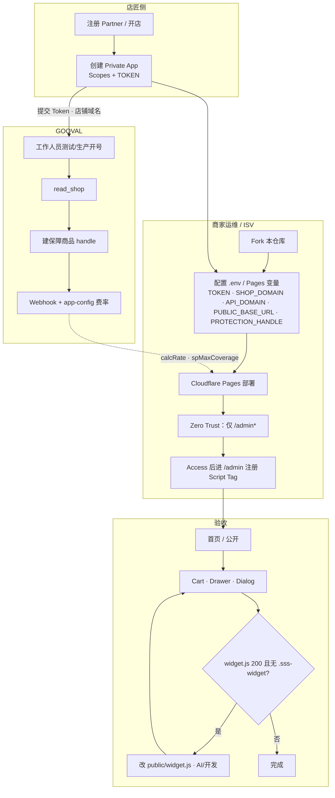
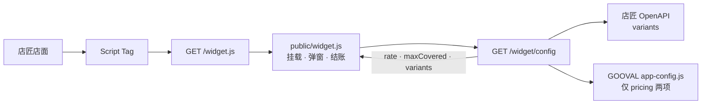
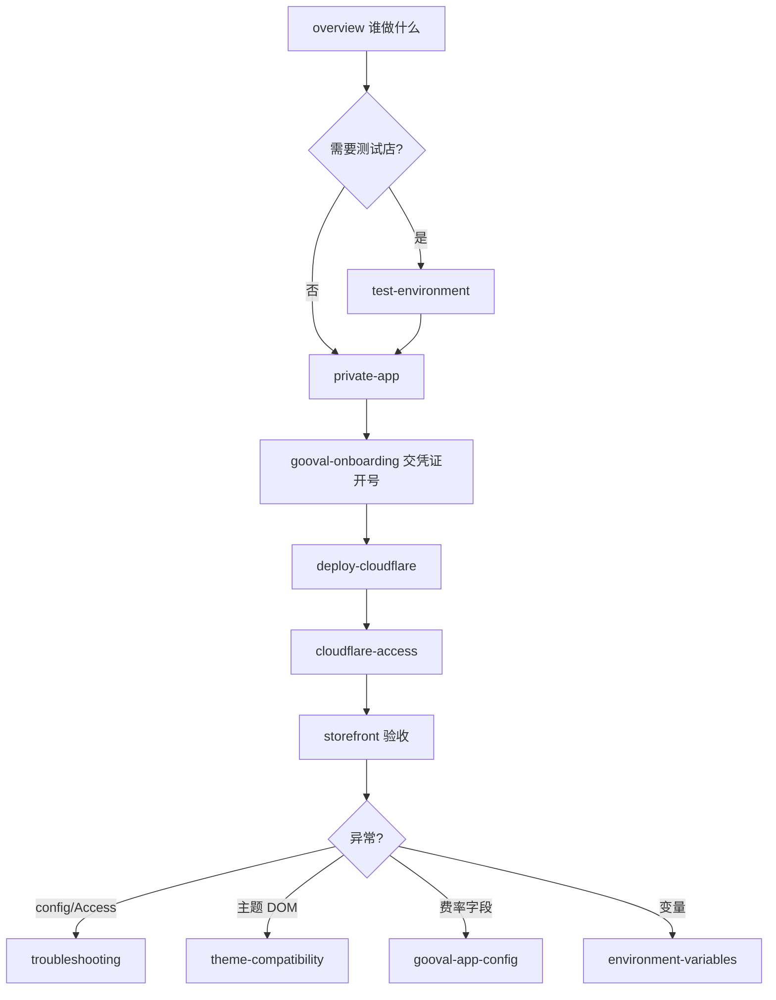
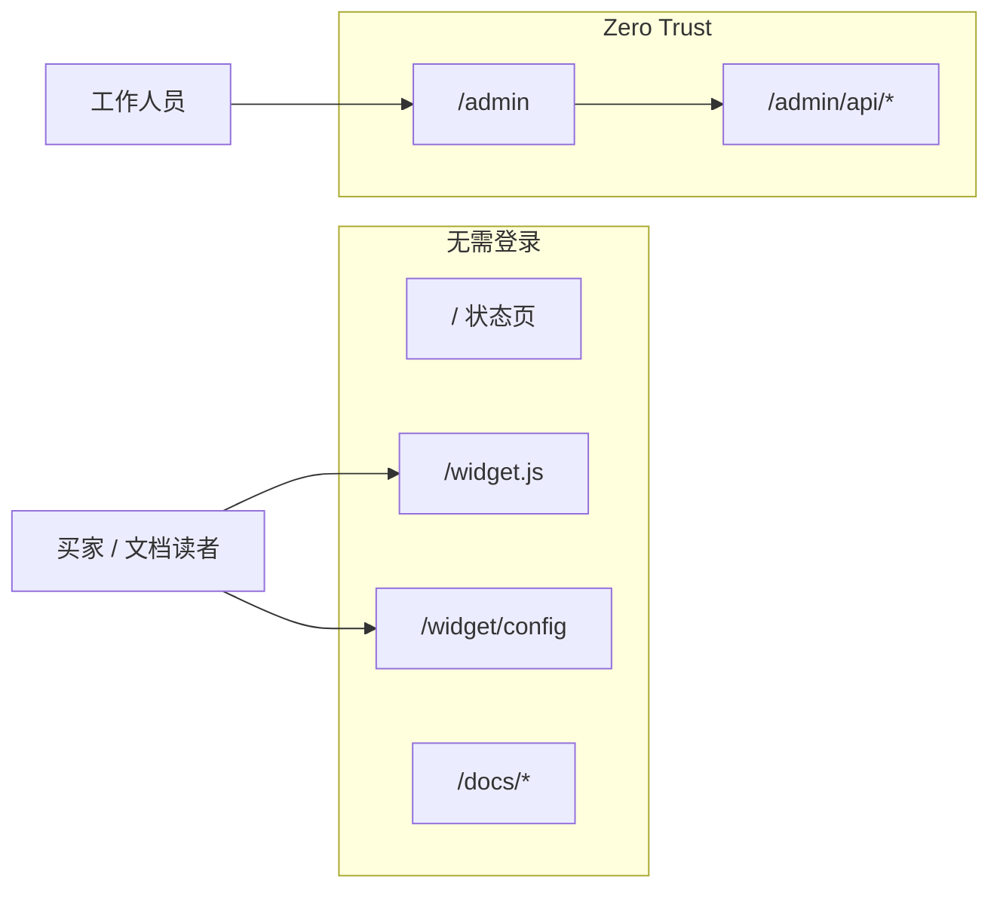

# 接入总览流程图

根据当前 `docs/shoplazza` 文档整理的端到端流程。**测试**与**生产**步骤相同，仅 `API_DOMAIN`（`sp-test` / `sp-prod`）与 GOOVAL 开号环境不同。

---

## 1. 端到端接入（谁 → 做什么）

---

## 2. 运行时：买家购物车加载链

---

## 3. 文档阅读顺序（对应流程节点）

---

## 4. Access 与公开路径（部署后）

---

## 相关文档

- [接入索引](./README.md)
- [测试环境](./test-environment.md)
- [GOOVAL 接入](./gooval-onboarding.md)