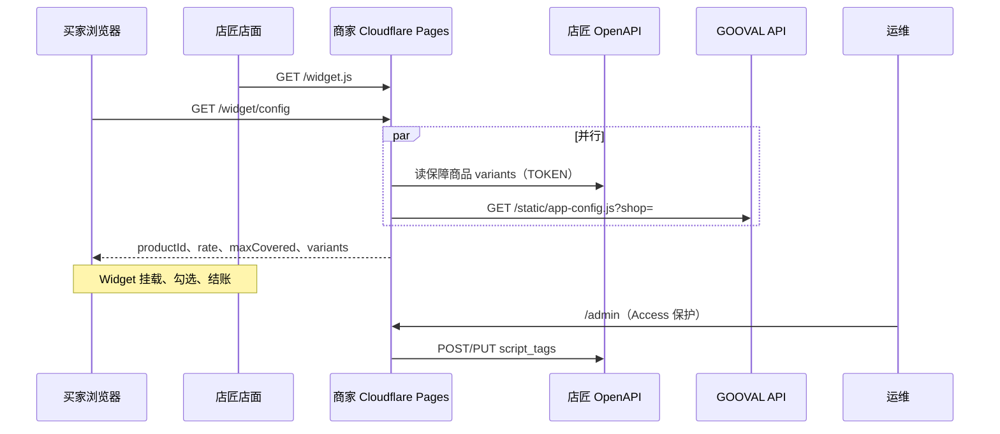

# Shipping Secure Service 本项目说明

本仓库是店匠侧的 **Shipping Secure Service 私有 App 前端 + 轻量运维面**：在 **商家自有的 Cloudflare Pages** 上托管购物车 Widget，并提供 **Script Tag 管理**（通过店匠 OpenAPI）。  
**商品创建、Webhook、GOOVAL 商家账户** 由 [GOOVAL 接入流程](./gooval-onboarding.md) 完成；**本仓库不负责** GOOVAL 平台业务与 Webhook 接收。

---

## 本项目做什么 / 不做什么

| 本项目负责 | 本项目不负责 |
|------------|--------------|
| 托管 `widget.js`、`wf-modal.css`、弹窗资源 | 在店匠创建 Private App（见 [private-app.md](./private-app.md)） |
| `GET /widget/config` 公开价档与费率（无 Token；费率优先来自 GOOVAL `app-config.js`） | GOOVAL 读店、建保障商品、注册 `orders/paid` 等 Webhook |
| **`/admin`：注册 / 更新 / 删除 Script Tag** | 店匠商家后台商品编辑 UI |
| Cloudflare **Functions** 用 `TOKEN` 调 OpenAPI（读商品、写 Script Tag） | 订单理赔、GOOVAL 商家端账号 |

**核心价值（对商家 / 运维）：** 克隆本仓库 → 配置环境变量 → **发布到商家自己的 Cloudflare** → 在受保护的 `/admin` 里把 `widget.js` 登记到店匠 Script Tag，买家购物车即可加载保障 Widget。

---

## 谁需要克隆并部署

- **商家自行运维**，或 **GOOVAL 交付后由商家指定团队** 运维时：  
  从本仓库 **clone**（或 fork），在 **该商家 Cloudflare 账号** 下创建 **Pages** 项目，绑定域名（`*.pages.dev` 或自定义域）。
- 每个商家（或每个店匠店铺）通常对应 **独立 Pages 部署** 与 **`PUBLIC_BASE_URL`**，Script Tag 的 `src` 指向该域上的 `widget.js`。  
- **不要** 多个无关店铺共用同一套未隔离的 `/admin` 与 `TOKEN`，除非明确为多店托管架构。

---

## 部署到 Cloudflare（概要）

图文并茂步骤见 [deploy-cloudflare.md](./deploy-cloudflare.md)。在线阅读整站文档：**`/docs`**。

1. **克隆仓库**，配置 Pages：构建命令 `npm run build`，输出目录 `dist`，Functions 目录 `functions/`。
2. **Variables and Secrets**：`TOKEN`、`SHOP_DOMAIN`、`PROTECTION_HANDLE`、`API_DOMAIN`（GOOVAL API 根 URL）、`WEBHOOK_API_VERSION`、`PUBLIC_BASE_URL`（线上 HTTPS，无尾斜杠）。费率与封顶由 **`API_DOMAIN` + `app-config.js`** 下发；仅本地或未接 GOOVAL 时可配 `PROTECTION_RATE`、`PROTECTION_MAX_COVERED` 兜底。
3. **构建并发布**；`PUBLIC_BASE_URL` 与 Pages 实际访问域名一致。
4. **Cloudflare One（Zero Trust）Access** 只保护 `/admin`、`/admin/api*`（及可选 `/`）；店面 **`/widget.js`、`/widget/config` 保持公开**。详见 [cloudflare-access.md](./cloudflare-access.md)。
5. 浏览器打开 **`/admin`（新窗口）** → 注册 Script Tag：`src = {PUBLIC_BASE_URL}/widget.js`，`display_scope` 建议 `index,collection,product,search,cart`。

本地调试：`npm run dev` → `http://localhost:8787`，详见 README。

---

## Script Tag 管理（本项目核心运维能力）

管理页与 CLI 均通过店匠 OpenAPI `script_tags` 操作（需 Private App **`write_script_tags`**）：

| 方式 | 说明 |
|------|------|
| **`/admin`（Vue）** | 经 Access 的管理员：刷新列表、**注册** / **更新** / **注销（删除）** Script Tag |
| **`npm run register-script`** | 本地用 `.env` 一次性注册（`src` 须为公网 HTTPS，非 localhost） |

店面加载链：

```text
店匠页面 ──Script Tag──▶ {PUBLIC_BASE_URL}/widget.js
                              │
                              ├── fetch /widget/config  （Functions + catalog）
                              │         ├── 店匠 OpenAPI → variants
                              │         └── GOOVAL app-config.js → rate / maxCovered
                              └── 购物车 / 抽屉 UI + 结账逻辑
```



---

## 与 GOOVAL 开号流程的衔接

推荐顺序见 [gooval-onboarding.md](./gooval-onboarding.md)：

1. 店主 → GOOVAL：Token、Secret、店铺域名等  
2. GOOVAL：读店、建品、Webhook、GOOVAL 商家账户与邮件  
3. **商家运维：克隆本项目 → 部署自有 Cloudflare → `/admin` 注册 Script Tag**  
4. 店主验车：购物车 Widget、弹窗、结账带保障  

---

## 相关文档

- [GOOVAL 接入店匠店铺](./gooval-onboarding.md)
- [创建私有应用](./private-app.md)
- [店面行为](./storefront.md)
- [One / Zero Trust 访问控制](./cloudflare-access.md)
- [联调与排障](./troubleshooting.md)
- [店匠接入索引](./README.md)
- [仓库 README — 部署与 Access](../../README.md)