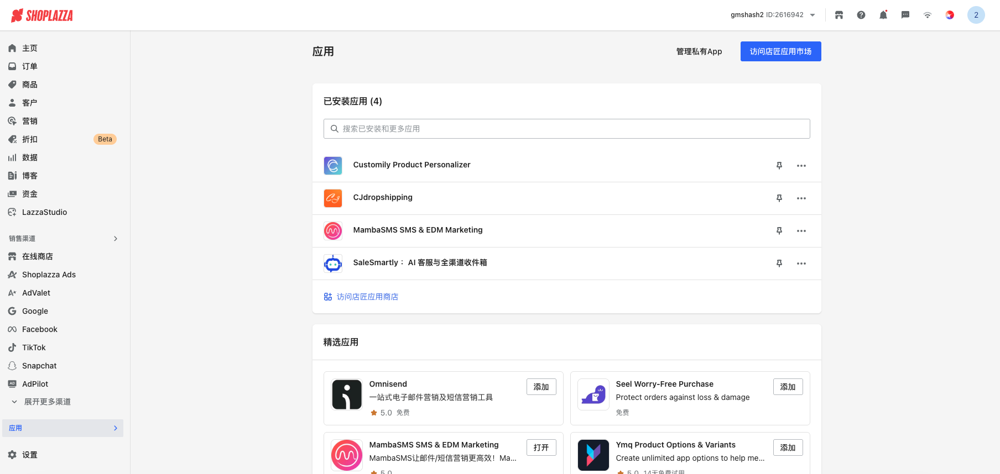
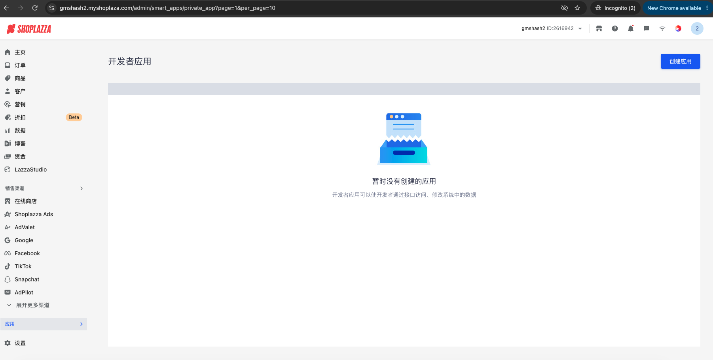
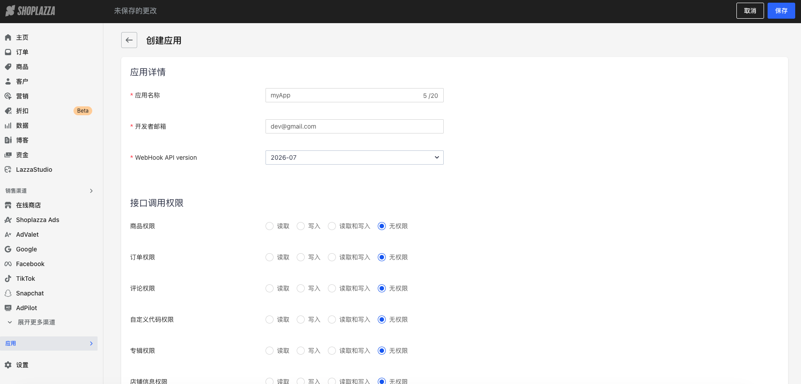
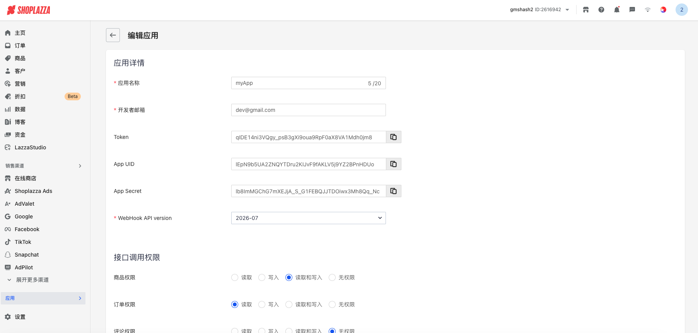

# 创建店匠私有应用（Private App）

在商家后台创建一枚 **私有应用**，拿到 **Token** 后写入本项目的 `.env`，用于 OpenAPI（读保障商品、注册 Script Tag 等）。

> **关于截图文字**  
> 配图里出现的 `myApp`、`dev@gmail.com`、`2024-07` 等为界面示意。实际接入请按下文 **「正确填写」** 操作，不要照搬截图里的占位内容。

---

## 步骤一：进入「管理私有 App」

登录 **店匠商家后台**（形如 `https://<店铺>.myshoplaza.com/admin`）。

1. 左侧导航点击 **应用**。
2. 页面上方点击 **管理私有App**（不要点「访问店匠应用市场」）。



---

## 步骤二：打开开发者应用列表

进入 **开发者应用** 页。若尚无应用，会显示「暂时没有创建的应用」。

点击右上角 **创建应用**。



---

## 步骤三：填写应用详情与接口权限

在 **创建应用** 页完成必填项，并配置 **接口调用权限**（需向下滚动，找到「商品」「自定义代码」等行）。

### 应用详情（正确填写）

| 字段 | 填写说明 |
|------|----------|
| **应用名称** | `Shipping Secure Service`（或贵司约定名称，最长按后台限制） |
| **开发者邮箱** | 可联系到的开发者或运维邮箱 |
| **WebHook API version** | **`2026-07`**（与 `.env` 中 `WEBHOOK_API_VERSION` 一致） |

### 接口调用权限（本项目必选）

在每一行权限单选中选择 **读取** / **写入** / **读取和写入** / **无权限**：

| 后台名称 | 应选择 | 对应 scope | 用途 |
|----------|--------|------------|------|
| **商品权限** | **读取和写入** | `read_product`、`write_product` | 按 handle 拉保障价档；对接方维护保障商品 |
| **订单权限** | **读取** | `read_order` | 对接 / 运维按订单核对保障（本仓库 Widget **不**调订单写接口） |
| **自定义代码权限** | **读取和写入** | `read_script_tags`、`write_script_tags` | `/admin` 注册、更新 `widget.js` Script Tag |
| **店铺信息权限** | **读取** | `read_shop` | 读店铺基础信息（OpenAPI） |
| **购物车转换** | **读取和写入** | `read_cart_transform`、`write_cart_transform` | 购物车侧转换能力（与店面结账链路配合） |
| 评论、专辑、客户等未列项 | **无权限** | — | 未使用可不开 |

最小 scope 集合（复制到 OpenAPI / 对接清单）：

```text
read_product,write_product,read_order,read_script_tags,write_script_tags,read_shop,read_cart_transform,write_cart_transform
```

填好后点击右上角 **保存**。



**说明：** 截图可能只露出前几行权限；请向下滚动，将 **自定义代码、店铺信息、购物车转换** 等按上表设好。缺 `write_script_tags` 时注册 Script Tag 会 **403**。

---

## 步骤四：保存后复制凭证

保存成功后会进入 **编辑应用** 页，在 **应用详情** 中复制以下信息。

### 写入本项目的环境变量

| 后台字段 | `.env` 变量 | 说明 |
|----------|-------------|------|
| **Token** | `TOKEN` | **必填**。Functions、`register-script`、读商品均用此 Access Token |
| App UID | `APP_UID` | 仅备份，**代码不读取** |
| App Secret | `APP_SECRET` | 仅备份，**代码不读取** |
| — | `SHOP_DOMAIN` | 店铺域名，如 `gmshash.myshoplaza.com`（无 `https://`） |
| — | `API_DOMAIN` | GOOVAL 交付的 API 根 URL（如 `https://sp-test.gooval.io`），用于拉取费率；由运维写入，**不在**店匠后台生成 |
| — | `PROTECTION_HANDLE` | 保障商品 handle，与 GOOVAL 建品一致 |

**WebHook API version** 在此页也应显示为 **`2026-07`**。若曾选错版本，请改回后 **重新保存 / 刷新 Token**（改权限后旧 Token 可能不含新 scope）。

费率 **`rate` / 封顶 `maxCovered`** 由 GOOVAL 在 `app-config.js` 中维护（见 [overview.md](./overview.md)），一般 **不必** 在 `.env` 再写 `PROTECTION_RATE`、`PROTECTION_MAX_COVERED`。



### `.env` 与私有 App 对齐

`.env` **第 1～4 行**应与后台 **应用详情** 一一对应：`TOKEN`、`APP_UID`、`APP_SECRET`、`WEBHOOK_API_VERSION=2026-07`。

其余变量（`API_DOMAIN`、`SHOP_DOMAIN`、`PUBLIC_BASE_URL`、`PROTECTION_HANDLE`）见 **[environment-variables.md](./environment-variables.md)**：

- **API_DOMAIN**：测试 `https://sp-test.gooval.io`，生产 `https://sp-prod.gooval.io`
- **SHOP_DOMAIN**：店匠提供的 `*.myshoplaza.com`
- **PUBLIC_BASE_URL**：部署后可访问地址（与 Script Tag `src` 一致）
- **PROTECTION_HANDLE**：GOOVAL 维护的保障商品 handle

完整说明与示例见 [environment-variables.md](./environment-variables.md)、根目录 [README.md](../../README.md)。

---

## 创建后检查清单

- [ ] Token 已写入 `.env`，且未提交到 Git  
- [ ] API 版本为 **2026-07**  
- [ ] 商品、自定义代码、购物车转换为 **读取和写入**；订单、店铺信息为 **读取**  
- [ ] 店铺已存在保障商品 handle：`PROTECTION_HANDLE`（默认可用 `gwofy-shipping-protection-qaqwer`）  
- [ ] `API_DOMAIN` 已与 GOOVAL 开号环境一致；首页或 `curl /widget/config` 可见合理 `rate` / `maxCovered`
- [ ] 本地 `npm run dev` 后打开首页，**管理**（新窗口）可注册 Script Tag  

---

## 相关文档

- [架构概览](./overview.md)  
- [联调与排障](./troubleshooting.md)
- [根目录 README — Scopes 与 Cloudflare Access](../../README.md)