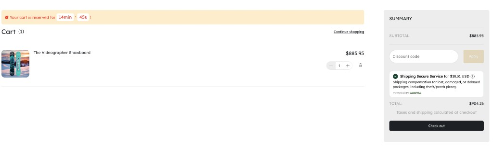
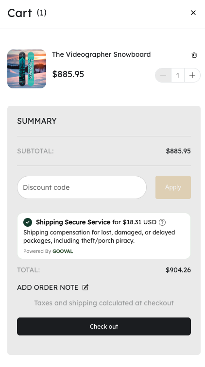
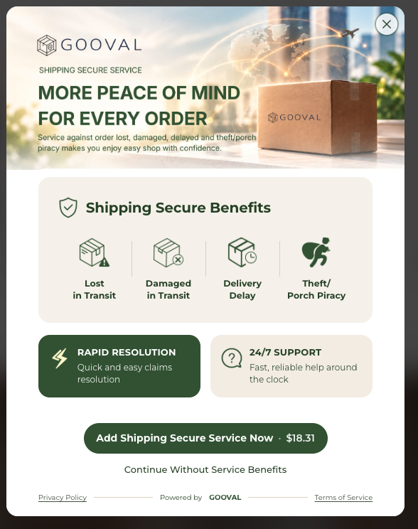

# 店面行为（购物车 Widget）

买家在店匠 **购物车页** 或 **购物车抽屉** 中看到 Shipping Secure Service 区块时的加载与结账逻辑。实现代码：`public/widget.js`。

---

## 加载链

1. 店匠按 Script Tag 加载 `{PUBLIC_BASE_URL}/widget.js`。
2. 脚本启动时 **请求一次** `GET {PUBLIC_BASE_URL}/widget/config`（跨域，CORS 开放）。
3. 返回 `productId`、`handle`、`rate`、`maxCovered`、`feeCap`、`variants`（价档列表）。
4. Widget 根据当前购物车 **非保障商品小计** 计算应收保障费，向上匹配最近变体价，且不超过 `feeCap`。

费率与封顶 **不** 写在店面脚本里，由服务端在 `/widget/config` 中下发（见 [定价来源](#定价来源)）。

---

## 定价来源

| 来源 | 字段 |
|------|------|
| 店匠 OpenAPI | 保障商品 `variants`（SKU / 价格阶梯） |
| GOOVAL `app-config.js`（`sp-test` / `sp-prod`，见 [gooval-app-config.md](./gooval-app-config.md)） | **仅此二项**：`pricing.calcRate` → `rate`；`pricing.spMaxCoverage`（分）→ `maxCovered`（元） |

未配置 `API_DOMAIN` 时，服务端用环境变量 `PROTECTION_RATE`、`PROTECTION_MAX_COVERED` 作为兜底（不推荐生产）。

---

## UI 挂载点

- **购物车抽屉**：结账按钮区域前插入 Widget。
- **购物车页**：CTA 区域（如 `.cart__ctas`）前插入。

`app-config` 中其余字段（如 `themeSelectors`）供 **Shopify 插件** 使用，店匠 Widget **不读**；挂载见 **`public/widget.js`**、[theme-compatibility.md](./theme-compatibility.md)。

**Script Tag 建议 `display_scope`：** `index,collection,product,search,cart`——覆盖加购抽屉与 **购物车页**，否则部分页面不会加载 `widget.js`。

---

## Script Tag 注册后：店面验收

在 `/admin` 注册 Script Tag（`src` 指向线上 `widget.js`）后，用 **买家身份**（关闭店铺密码墙、无痕窗口）加购并检查三处 UI。

### 1. 购物车页（Cart）

打开 `/cart`，SUMMARY 区域应出现 **Shipping Secure Service**，展示按小计计算的保障费（示例 `$18.31`）、说明文案与 **Powered By GOOVAL**。

### 2. 购物车抽屉（Cart Drawer）

在商品页加购后打开 **侧栏购物车**，SUMMARY 中同样应出现保障区块与合计（小计 + 保障费）。

### 3. 说明弹窗（Dialog）

点击 Widget 内说明 / 信息入口，应弹出 **Shipping Secure Service** 模态框（`wf-modal.css` + `dialog`）：权益说明、**Add Shipping Secure Service Now · $价格**、**Continue Without Service Benefits** 等。

若三处均无区块：查 Network **`widget.js`、`/widget/config` 为 200**、Script Tag 的 `src` / `display_scope`、是否误把整站加了 Cloudflare Access。见 [troubleshooting.md](./troubleshooting.md) 与 [cloudflare-access.md](./cloudflare-access.md)。

---

## 买家操作流程

| 行为 | 说明 |
|------|------|
| 默认展示 | 勾选「Shipping Protection」、展示费率对应价档金额 |
| 主结账按钮 | 勾选保障时：发起带保障的结账会话（购物车可不长期保留保障行） |
| **Checkout without protection** | 不勾选保障，直接结账 |
| 信息弹窗 | 点击 Widget 内说明入口打开 `dialog`；样式外链 `wf-modal.css` |
| 弹窗双按钮 | 与购物车主区域一致：带保障 / 不带保障结账 |

加车、改数量会触发购物车事件，Widget 会 **重新挂载 / 同步展示**；**不会** 再次请求 `/widget/config`。

---

## 与购物车的数据关系

- 计费用 **排除保障商品行** 后的小计。
- 多商品时按 eligible 小计选 **一档** 保障变体，`quantity: 1`。
- 勾选结账与弹窗 CTA 走同一套 `startCheckoutSession` 逻辑（与「仅 checkout body 带保障」约定一致）。

---

## 配置何时更新（买家侧）

| 场景 | 是否用新费率 / 价档 |
|------|---------------------|
| 同一页面内加车、开抽屉 | **否**（沿用首次加载的 `config`） |
| 刷新整页或新开标签进店 | **是**（重新 `fetch /widget/config`） |
| 运维 curl `/widget/config` | **是**（每次请求服务端会重新拉 GOOVAL + OpenAPI，响应 `Cache-Control: no-store`） |

GOOVAL 后台改费率后，**已打开的购物车页不会自动变价**；买家需刷新。若需产品级「热更新」，需改 `widget.js` 增加定时或可见性重拉配置（当前未实现）。

---

## 相关文档

- [架构概览](./overview.md)
- [联调与排障](./troubleshooting.md)
- [GOOVAL 接入](./gooval-onboarding.md)